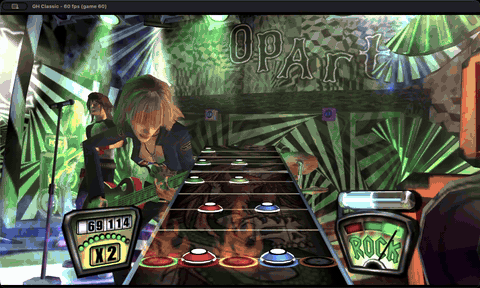

> [!NOTE]
> GH Classic is in active development. Expect bugs, missing features and things changing between releases.

# Guitar Hero Classic



**Guitar Hero Classic** is a modded recompilation of Guitar Hero II for the PS2 that runs natively on Windows, macOS and Linux. It aims to create the most streamlined experience for playing all 3 of the classic Harmonix Guitar Hero games in a single package with minimal setup required.

[](https://discord.gg/EtQcnHqn3)

## Features

- Fully playable campaigns for Guitar Hero, Guitar Hero 2 (both on PS2 and Xbox 360) and GH80s
- Swap between the note engine of GH2, or GH1 if you really hate yourself
- Quickplay mixing featuring every song from every game, for every character skin, with every guitar, in every venue
- Local multiplayer
- Custom Vulkan rendering engine lets you play with the PS2's original look, the Xbox 360's, or anything in between
- Any resolution, uncapped frame rate, plus MSAA, TAA, and mipmaps
- Modern QOL improvements like note streaks, custom note speed and highway lengths, independent A/V sync, and more!
- Autodetects guitar, gamepad, and keyboard controls
- Photo mode

## Requirements
- Legally obtained disc images for the following games in `.chd`, `.iso` or `.bin`:
  - **Required:**
    - Guitar Hero II (PS2), USA only (SLUS-21447)
  - **Optional, any region:**
    - Guitar Hero (PS2)
    - Guitar Hero II (360)
    - Guitar Hero Encore: Rocks the 80s (PS2)
- A GPU with Vulkan support

## Install

Grab the latest [Releases](https://github.com/noahbaxter/GHClassic/releases).

- **Windows and Linux:** unzip the portable folder install anywhere and put your disc images in the `PUT_DISC_HERE` folder beside the game. Windows will show a SmartScreen prompt the first time since the exe is unsigned: More info, then Run anyway.
- **macOS:** open the disk image and drag GH Classic to Applications. Run it once and it opens the folder your disc images go in (`~/Library/Application Support/GHClassic/PUT_DISC_HERE`).

### Game files

Everything GHC needs is stored in one folder. Windows and Linux are portable installs, so just place the extracted zip anywhere you want. On macOS it's at `~/Library/Application Support/GHClassic`.

| Item             | Description                               |
| ---------------- | ----------------------------------------- |
| `PUT_DISC_HERE/` | Your disc images                          |
| `settings.ini`   | Every setting, includes some not in menus |
| `input.ini`      | Controller bindings                       |
| `save.bin`       | All bands progress                        |
| `GHClassic.log`  | The last session's log, for bug reports   |

## Controls

|            | Keyboard            | Gamepad           |
| ---------- | ------------------- | ----------------- |
| Frets      | `1` `2` `3` `4` `5` | L2 L1 R1 R2 Cross |
| Strum      | Up, Down            | D-pad up, down    |
| Start      | Enter               | Start             |
| Star power | Right Shift         | Select            |
| Whammy     |                     | Left stick up     |

Certain guitars with built-in profiles should auto detect: PS3, Wii (through a raphnet adapter), Xbox 360, Rock Band 4 and World Tour PC. Anything else can be remapped in-game.

There's also `input.ini` that lists every device's current bindings, which sits beside the game on Windows and Linux, and in `~/Library/Application Support/GHClassic` on macOS.
Fullscreen is `Cmd+F` on macOS, `F11` elsewhere.

## Building from source

Needs Git, Python 3.11+, and Xcode Command Line Tools on macOS. Linux also needs a C++ compiler and SDL's build headers (Fedora below; on Bazzite or SteamOS, build in a distrobox).

```sh
git clone --recurse-submodules https://github.com/noahbaxter/GHClassic.git && cd GHClassic
scripts/play.sh "/path/to/Guitar Hero II (USA).iso"   # scripts\play.cmd on Windows
```

<details><summary>Linux packages (Fedora)</summary>

```sh
sudo dnf install gcc-c++ libX11-devel libXext-devel libXrandr-devel libXcursor-devel libXfixes-devel libXi-devel libXScrnSaver-devel libXtst-devel libXinerama-devel libxkbcommon-devel wayland-devel wayland-protocols-devel mesa-libGL-devel mesa-libEGL-devel libdrm-devel mesa-libgbm-devel libdecor-devel alsa-lib-devel pulseaudio-libs-devel pipewire-devel dbus-devel ibus-devel systemd-devel libusb1-devel
```
</details>

## How Was AI Used?

Generative AI was used to write code and nothing else. This README and any other text a user may see is 100% written by me (or the original developers).

No texture, image, video, audio file or any other game asset was generated or AI upscaled. Some assets like fonts and glyphs were vectorized through tracing or modified through image manipulation tools like GIMP and PIL scripts, but the vast majority of what you see is what is on the discs, just rendered at a higher resolution and framerate. In some cases assets are converted at run time for inter-engine compatibility.

The game is recompiled with my [fork](https://github.com/noahbaxter/PS2Recomp/tree/ghrecomp) of the [PS2Recomp](https://github.com/ran-j/PS2Recomp) project and runs original game code (mostly) unchanged. Everything built around that core recomp (renderer, audio, input, saves, etc.) was written with Claude Code. To be clear I've been a professional software developer since 2018 and while this is my first time playing around with emulation/graphics, I am not "vibe coding" something I have no understanding of. All code is reviewed, and all macro decisions are ultimately being painstakingly made by me.

## Credits

This project is built on top of a lot of excellent work by others. Please give most of the credit to these fine folk.

- [PS2Recomp](https://github.com/ran-j/PS2Recomp) ([fork](https://github.com/noahbaxter/PS2Recomp/tree/ghrecomp))
- [luisfelipe1004](https://github.com/luisfelipe1004): [performance patches](https://github.com/noahbaxter/GHClassic/compare/a04cdbfc...d3485bef) for steady frame pacing
- Project Deluge: debug builds of GH1, GH2 and Rocks the 80s that the function names come from, matched onto the retail executable
- [MiloHax](https://github.com/hmxmilohax): those builds collected ([milo-executable-library](https://github.com/hmxmilohax/milo-executable-library)), menu script references ([milo-script-library](https://github.com/hmxmilohax/milo-script-library)), and [gh2-calibration-fix](https://github.com/hmxmilohax/gh2-calibration-fix)
- [PCSX2](https://github.com/PCSX2/pcsx2) and [psx-spx](https://psx-spx.consoledev.net/): SPU2 reference code/reverb coefficients
- [ps2tek](https://github.com/PSI-Rockin/ps2tek): PS2 hardware reference
- [ps2sdk](https://github.com/ps2dev/ps2sdk) and mymc: memory card format, sound library names
- [libchdr](https://github.com/rtissera/libchdr): reading `.chd` disc images
- [Redump](http://redump.org/): disc hashes the images are checked against
- ["Silent Hill 3 Ps2 Game cover"](https://skfb.ly/oR9ZT) by eyewideasca, [CC-BY 4.0](https://creativecommons.org/licenses/by/4.0/): the campaign picker's game case
- [generalrose](https://www.steamgriddb.com/grid/681069) and [David0Mario](https://www.steamgriddb.com/logo/59969) on SteamGridDB: the icon's GH2 cover art and GH1 logo
- [Staszek Szybki Jest](https://commons.wikimedia.org/wiki/File:Simple_gold_crown.svg) on Wikimedia Commons: the full combo crown (public domain)

## License

GPL-3.0, see [LICENSE](LICENSE).

This is an unofficial fan project, not affiliated with or endorsed by Activision, Harmonix or RedOctane. Guitar Hero and all related names, marks and games belong to their owners. This repository does not include any game assets. You need your own copy of the game to build or play it.